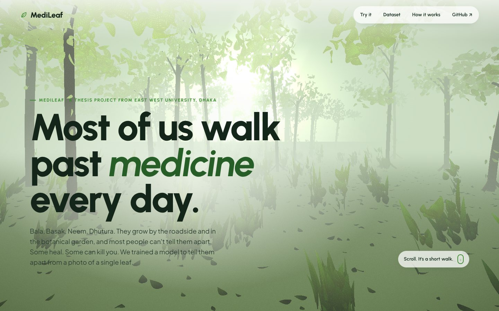
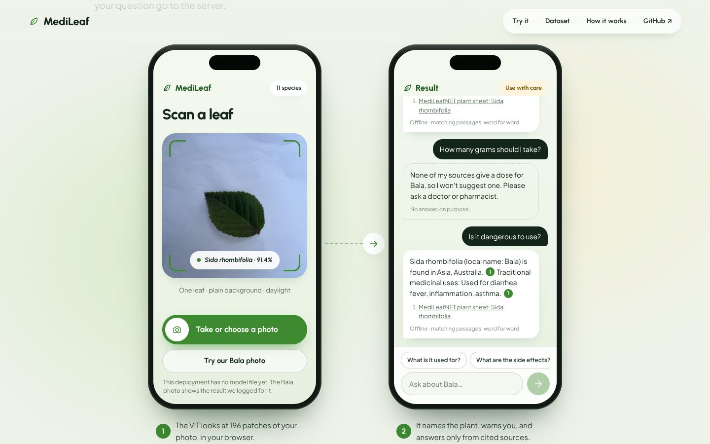

# MediLeafNET

**An AI-Driven Multimodal System for Medicinal Plant Discovery and Ethnobotanical Knowledge Retrieval in Bangladesh**

[](https://medi-leaf-net.vercel.app)
[](https://doi.org/10.17632/9tdc9gbtgb.2)

Bangladesh has hundreds of medicinal plants, but most of what is known about them is scattered across local research and traditional practice. Identifying a plant also usually requires an expert. MediLeafNET takes a photo of a single leaf, identifies the species, and returns what is documented about it: local name, traditional uses, active compounds, clinical evidence, and side effects.

The project started as our undergraduate thesis at East West University. This repository contains two parts:

| Part | Folder | What it is |
|---|---|---|
| **Thesis prototype** | [`Multimodal(ViT+BERT)/`](./Multimodal(ViT+BERT)) | Vision Transformer classifier with a fine-tuned BART text generator, served locally through Gradio |
| **Web application** | [`web/`](./web) | Production version, live at **[medi-leaf-net.vercel.app](https://medi-leaf-net.vercel.app)**: the same classifier runs in the browser, and a retrieval-augmented assistant answers questions with cited sources |



---

## Research Gap


---

## Features

- **Leaf-based identification:** a Vision Transformer trained from scratch on our own images classifies 11 medicinal species found in Bangladesh.
- **Confidence gating:** below 70% confidence, the system names no plant and generates no information.
- **Ethnobotanical knowledge:** each species links to a curated record of local name, region, traditional uses, active compounds, clinical evidence, and side effects.
- **Cited answers (web app):** questions are answered through retrieval-augmented generation. Every sentence must cite a source passage, and uncited sentences are removed before display.
- **Safety by design:** three of the eleven species are toxic, so dose, recipe, and treatment questions are always refused.
- **On-device inference (web app):** the model is exported to ONNX (int8, 11.4 MB) and runs in the browser, so photos never leave the user's device.

---

## System Workflow


### Thesis prototype

1. The uploaded leaf image is resized to 224 × 224 and normalized.
2. The Vision Transformer (6 layers, 384-dim embeddings, 6 attention heads, about 11M parameters) predicts the species.
3. If confidence is at least 0.70, the plant record is passed to a fine-tuned BART model, which writes a short description.

### Web application

1. **Identify:** the same ViT runs in the browser through ONNX Runtime Web.
2. **Rewrite:** an LLM (`gpt-oss-20b` on Groq) turns follow-up questions into standalone search queries.
3. **Retrieve:** hybrid search over plant records and Wikipedia passages (BM25, plus optional vector search with Upstash Vector), merged with reciprocal rank fusion.
4. **Answer:** `gpt-oss-120b` writes an answer that cites the retrieved passages. General knowledge, when used, is labelled as such.
5. **Check:** uncited sentences are removed, and dose questions are refused before any model runs.

Full details are in [`web/README.md`](./web/README.md) and [`web/MODEL_CARD.md`](./web/MODEL_CARD.md).

---

## Demo

### Web application



### Thesis prototype: before prediction


### Thesis prototype: after prediction


---

## Getting Started

### Option 1: Use the live app

Open **[medi-leaf-net.vercel.app](https://medi-leaf-net.vercel.app)**. No installation is needed. The `/playground` page supports single-image testing, batch testing, and full chat.

### Option 2: Run the thesis prototype locally

**Requirements:** Python 3.10 or 3.11

```bash
git clone https://github.com/SifatSwapnil2022/MediLeafNET.git
cd "MediLeafNET/Multimodal(ViT+BERT)"
python -m venv .venv
```

Activate the environment:

```bash
# Windows (PowerShell)
.venv\Scripts\Activate.ps1

# macOS / Linux
source .venv/bin/activate
```

Install dependencies:

```bash
pip install -r requirements.txt
```

**Model weights:** the trained ViT checkpoint (`.pth`) and the BART model weights are too large for GitHub and are not included in this repository. Place them in the project folder, then update the paths in `config.json`:

```json
{
  "device": "cpu",
  "vit_checkpoint_path": "best_vit_model.pth",
  "bart_model_dir": "bart-plants",
  "text_csv_path": "CapC_medicinal_plants_with_id.csv"
}
```

Set `"device"` to `"cuda"` if you have a compatible GPU.

Launch the app:

```bash
python app_gradio.py
```

Then open the local URL Gradio prints (usually `http://127.0.0.1:7860`) and upload a leaf image.

### Option 3: Run the web application locally

**Requirements:** Node.js 20 or newer

```bash
cd web
npm install
npm run dev
```

The app works without API keys, using keyword search and showing matching passages directly. For full LLM answers, copy `.env.example` to `.env.local` and add a free Groq API key. Never commit this file.

---

## Project Structure

```
MediLeafNET/
├── Multimodal(ViT+BERT)/              Thesis prototype
│   ├── app_gradio.py                  Gradio interface
│   ├── multimodal_pipeline.py         Image-to-text pipeline
│   ├── config.json                    Model and path settings
│   ├── CapC_medicinal_plants_with_id.csv   Ethnobotanical records (11 species)
│   ├── bart-plants/                   Fine-tuned BART config and tokenizer
│   └── utils/                         ViT model, loaders, prediction, text generation
└── web/                               Production web application
    ├── src/                           React + Three.js front end
    ├── api/                           Vercel serverless functions
    ├── server/, shared/               RAG pipeline and source passages
    ├── scripts/                       ONNX export, data ingestion, evaluation
    └── MODEL_CARD.md                  Model details, limitations, intended use
```

---

## Dataset

- **Images:** all leaf images were collected and curated by the MediLeafNET team (**Momena Khatun Zinia, Md Sifatullah Sheikh, Urmi Kirtonia, Mahmudul Haque Sakib**) at the National Botanical Garden, Bangladesh. The classifier is trained on 3,289 images of 11 species.
- **Public release:** *A Medicinal Plant Leaf Image Dataset of 13 Species Collected in Bangladesh*, Mendeley Data, Version 2, 2026. DOI: [10.17632/9tdc9gbtgb.2](https://doi.org/10.17632/9tdc9gbtgb.2)
- **Ethnobotanical records:** compiled by the team from local research and documentation.
- **Web app passages:** the web application also cites Wikipedia articles (CC BY-SA 4.0). Each passage keeps its source link.

---

## Limitations

- The classifier recognises only the 11 species it was trained on. Any other plant will either be rejected by the confidence threshold or misidentified.
- Images were collected in one location, so accuracy may drop for leaves photographed in very different lighting, backgrounds, or growth stages.
- MediLeafNET is a research and educational tool. **It is not medical advice.** Several of these plants are toxic. Always consult a qualified professional before any medicinal use.

---

## Contributing

- **Report a bug:** open an [Issue](https://github.com/SifatSwapnil2022/MediLeafNET/issues) with steps to reproduce.
- **Suggest a change:** fork the repository, make your changes on a new branch, and open a Pull Request.

---

## Acknowledgements

- **The National Botanical Garden of Bangladesh** and its Director, for granting access for image collection.
- **East West University**, Department of Computer Science and Engineering.
- Open-source projects: PyTorch, Hugging Face Transformers, Gradio, ONNX Runtime, React, and Three.js.
- Everyone who helped with testing and validation.

---

© 2026 Md Sifatullah Sheikh. All rights reserved.
