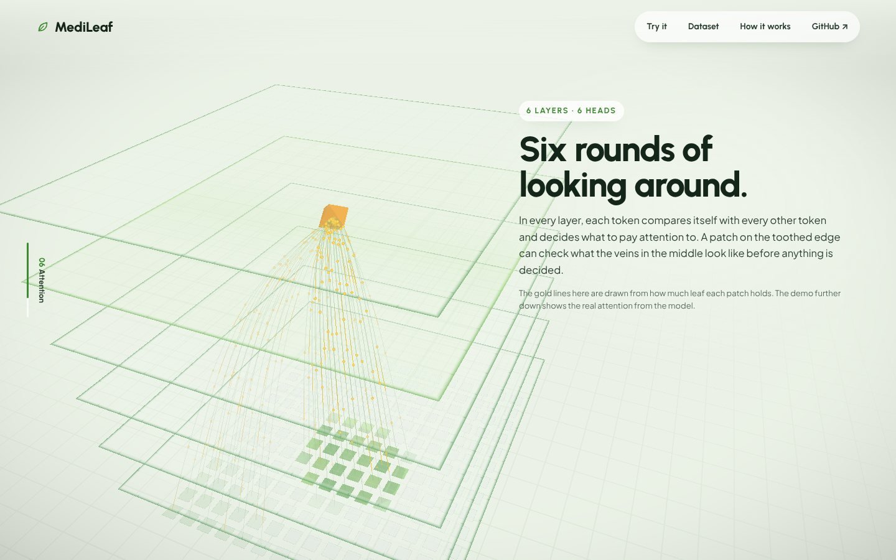
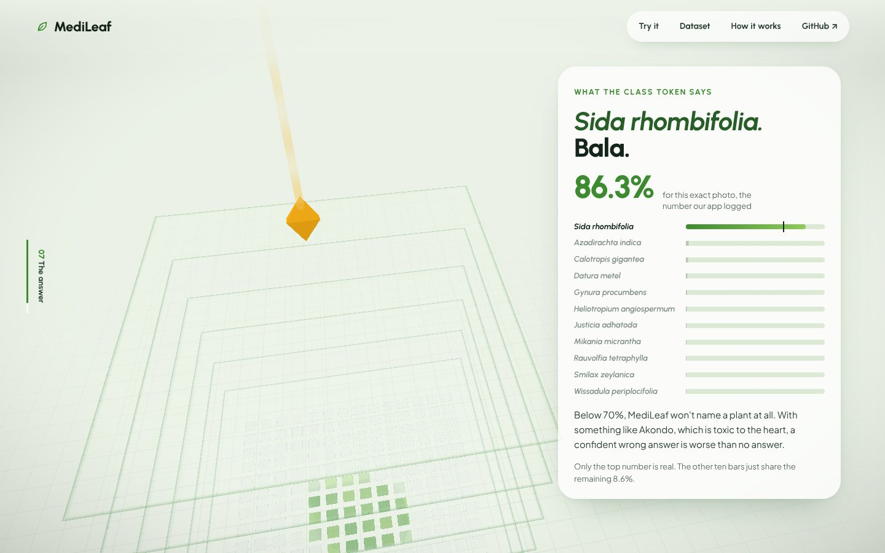

# MediLeafNET

Identify a medicinal plant of Bangladesh from a photo of one leaf, then ask anything about it. Answers cite their sources; anything beyond the sources is labelled as general knowledge.

**Live:** [medi-leaf-net.vercel.app](https://medi-leaf-net.vercel.app) · **Playground:** `/playground` · **Dataset:** [Mendeley Data, DOI 10.17632/9tdc9gbtgb.2](https://doi.org/10.17632/9tdc9gbtgb.2) · **Thesis code:** [MediLeafNET](https://github.com/SifatSwapnil2022/MediLeafNET)


| | |
|---|---|
|  |  |
|  |  |

## How it works

1. **Identify, on device.** A Vision Transformer I trained from scratch (6 layers, 384-d, 6 heads, 11M parameters) runs in the browser through ONNX Runtime Web, quantized to int8 (11.4 MB). The photo never leaves the device. Below 70% confidence it names nothing.
2. **Understand the question.** `gpt-oss-20b` on Groq rewrites the question so it stands alone (follow-ups like "is it safe for kids?" are resolved from the chat) and phrases it three ways for search.
3. **Find passages.** Hybrid retrieval over the plant sheets and Wikipedia passages for that one species: BM25 on every phrasing, plus Upstash Vector semantic search when configured, merged with reciprocal rank fusion.
4. **Answer.** `gpt-oss-120b` returns JSON with two fields: `sourced`, where every sentence must cite a passage, and `general`, a short, clearly labelled note used only when the sources fall short. Off-topic questions are declined.
5. **Check.** Sentences without a valid citation are removed. Dose, recipe and treatment-plan questions are refused before any model runs, and again if the rewrite turns into one.

If no Groq key is set, the site still works: it falls back to keyword search and shows the matching passages as they are.

## Pages

- `/` the scroll story, the two-phone demo, dataset and pipeline
- `/playground` single-photo identification with top-5 and attention map, a batch tester (accuracy from file names like `Datura_Metel_04.jpg`), and a full chat with passages shown under each answer
- `/api/ask` POST `{ plant, question, history? }`
- `/api/health` what this deployment has switched on (no secrets)

## Deploy to Vercel, step by step

**What you need:** Node 20+, a GitHub account, a Vercel account (Hobby is free), a Groq account (free). Upstash is optional.

### 1. Export the model (once, on your PC)

```powershell
cd "F:\CAPSTONE_C\Thesis_App\Multimodal(ViT+BERT)\medileaf\medileaf"
.venv\Scripts\Activate.ps1
python scripts\export_onnx.py --repo "F:\CAPSTONE_C\Thesis_App\Multimodal(ViT+BERT)" --ckpt "F:\CAPSTONE_C\Thesis_App\Multimodal(ViT+BERT)\best_custom_vit_model.pth" --out public\model
```

This writes `public/model/medileaf_vit_int8.onnx` and `labels.json`. The `.pth` stays on your PC.

### 2. Build the knowledge base (recommended)

```powershell
pip install requests pandas upstash-vector
python scripts\ingest.py --csv data\CapC_medicinal_plants_with_id.csv --wikipedia --dry-run
```

This adds Wikipedia passages to `shared/wiki-chunks.ts`, which makes answers far broader than the 44 plant-sheet passages alone. Drop `--dry-run` after step 4 to also load them into Upstash.

### 3. Get a Groq key

console.groq.com → API Keys → Create. Copy it.

### 4. (Optional) Create an Upstash Vector index

console.upstash.com → Vector → Create Index → type **Dense**, metric **Cosine**, pick a **built-in embedding model**. Copy the REST URL and token. Then rerun step 2 without `--dry-run`, with the two values set:

```powershell
$env:UPSTASH_VECTOR_REST_URL="..."; $env:UPSTASH_VECTOR_REST_TOKEN="..."
python scripts\ingest.py --csv data\CapC_medicinal_plants_with_id.csv --wikipedia --reset
```

### 5. Test locally

```powershell
copy .env.example .env.local     # paste your keys into it
npm install
npm run dev                      # http://localhost:5173 and /playground
```

The playground's status pills should read "Model loaded in browser" and "Live answers".

### 6. Push to GitHub

```powershell
git init
git add .
git commit -m "MediLeafNET"
git branch -M main
git remote add origin https://github.com/<you>/medileafnet.git
git push -u origin main
```

`.gitignore` keeps out `.venv`, `.env.local`, `*.pth` and the fp32 model.

### 7. Import into Vercel

vercel.com → Add New → Project → import the repo. It detects Vite. Before clicking Deploy, open **Environment Variables** and add `GROQ_API_KEY` (and the two Upstash values if you made the index). Deploy.

### 8. Check the deployment

Open `https://<your-project>.vercel.app/api/health`. It should show `"answers": "live"`. Then try `/playground`.

### 9. (Optional) Measure the live pipeline

```powershell
python scripts\eval.py --api https://<your-project>.vercel.app --judge
```

Commit `public/eval/results.json` and push; Vercel redeploys and the "How it works" numbers update.

## Evaluation

`data/eval_set.jsonl` (59 questions) was used while building. `data/eval_holdout.jsonl` (54 questions, worded differently) is never tuned on, and it's the only set the site reports. On it, plain keyword search found the right passage only 4.5% of the time, against 100% on the tuning set. That gap is why the live pipeline rewrites questions and uses hybrid search.

## Project layout

```
api/                 Vercel functions: ask.ts, health.ts
server/pipeline.ts   rewrite → hybrid retrieval → answer → citation check
shared/              plant data, passages, BM25, prompts (browser + server)
src/                 story page, two-phone demo, sections
src/playground/      the testing page
src/three/           forest, Bala shrub, photo → patches → tokens → layers
scripts/             export_onnx.py, ingest.py, eval.py, eval-offline.ts
```

---

© Md Sifatullah Sheikh. All rights reserved. Research demo, not medical advice.
